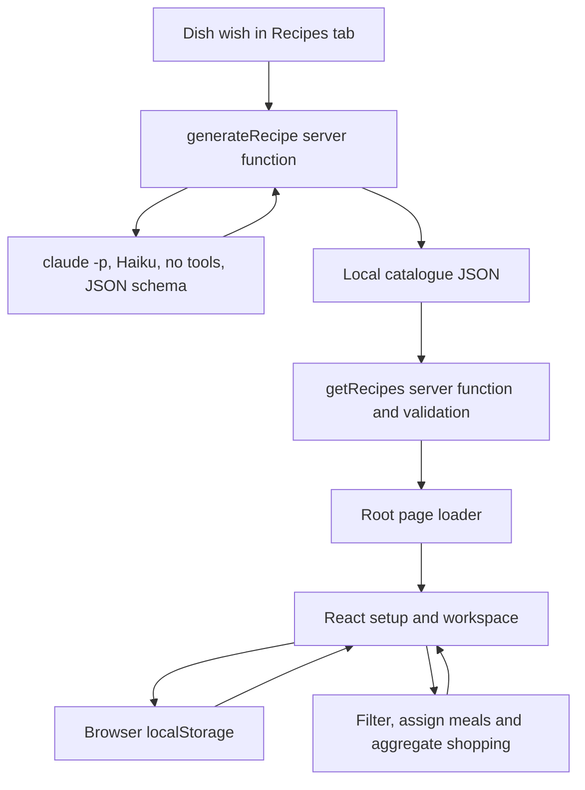

# Architecture

Batchday is a local, single-user meal planner built with TypeScript, React, TanStack Start and Vite. The working product flow and most domain logic are reusable. A hosted version needs more than a storage swap: user-state persistence, access control, source quality and broader UI verification remain separate work.

[PRODUCT.md](PRODUCT.md) records current capabilities and open product decisions. [README.md](README.md) covers setup and contribution boundaries. Personal assistant instructions and installed skills remain local and are excluded from Git.

## Current data flow

Generation and feedback run only on explicit user requests, never on page loads. `reviseRecipe` sends the original recipe plus feedback to the same tool-less CLI, then saves a new recipe with `source.basedOn` and `source.feedback`. The CLI receives 140 food IDs/names from the server-only BLS snapshot; code calculates per-serving macros from ingredient food IDs and edible grams. The CLI call is local-only; a hosted version replaces `runClaude` with an HTTP model call. A missing catalogue file loads as an empty catalogue. The route loader receives the whole validated catalogue through a TanStack Start server function; the browser then filters and calculates shopping locally.

There is no database service, authentication, server-side plan persistence, service worker or background synchronization. Local files remove runtime source requests; that alone does not make the app fully usable offline.

## File responsibilities

| Location | Responsibility |
| --- | --- |
| [src/lib/types.ts](src/lib/types.ts) | Shared recipe, ingredient, filter, schedule, plan and shopping contracts. |
| [src/lib/recipes.ts](src/lib/recipes.ts) | Pure catalogue validation, discovery, weekly assignment, quantity normalization and shopping arithmetic. No React or storage dependency. |
| [src/lib/recipes.test.ts](src/lib/recipes.test.ts) | Domain examples and edge cases, including scaling, missing data, units, filters and meal slots. |
| [src/lib/nutrition.ts](src/lib/nutrition.ts) | Pure all-or-nothing nutrient calculation from explicit ingredient grams, with [focused tests](src/lib/nutrition.test.ts). |
| [src/lib/catalog.ts](src/lib/catalog.ts) | Server-only catalogue/BLS reads, tool-less generation and feedback, mapping, calculated nutrition and serialized atomic append. Main recipe-storage boundary. |
| [data/nutrition.json](data/nutrition.json) | 140 BLS foods per 100 g edible portion. [Metadata](data/nutrition-source.json) preserves licence/source/selected IDs; [importer](scripts/import-nutrition.mjs) reproduces the snapshot. Never loaded into the client bundle. |
| [src/routes/index.tsx](src/routes/index.tsx) | Route loader/search, setup journey, workspace, recipe page, browser persistence and event handlers. |
| [src/routes/__root.tsx](src/routes/__root.tsx) | HTML document, English language, metadata and stylesheet. |
| [src/router.tsx](src/router.tsx) | Router creation, generated tree and scroll restoration. |
| [src/routeTree.gen.ts](src/routeTree.gen.ts) | Generated route registry; regenerate from route files, do not edit by hand. |
| [src/styles.css](src/styles.css) | Shared visual design and responsive layouts. |
| [THIRD_PARTY.md](THIRD_PARTY.md) | BLS attribution and separate data licensing; the public app uses supermarket names without brand artwork. |
| [vite.config.ts](vite.config.ts) | Active TanStack Start/React build and loopback development server configuration. |
| [wrangler.jsonc](wrangler.jsonc) | Retained Cloudflare scaffold; not an active deployment or database configuration. |

The app currently has one page route, `/`. Full recipe pages use `/?recipe=<id>` and optionally `&slot=<day>-<meal>` for a weekly meal or `&slot=recipe:<id>` for an unscheduled extra; they render a page rather than a modal. The optional slot identifies the plan item being edited. Tabs and setup screens are React state, not separate routes.

## Storage and ownership

| Store | Contents and lifecycle |
| --- | --- |
| `data/recipes.local/catalog.json` | Original generated recipes and immutable feedback variants; appends serialize the latest read/write inside one Node process, using unique temp files + rename. Absent means empty. |
| `localStorage["batchday-poc"]` | This browser origin's store, preferences, setup progress, schedule, plan, pantry, active tab and shopping checks. |

The `*.local` ignore rule keeps the catalogue and proof files out of version control. It does **not** prevent files under `public/` from being served or included in builds. Personal corrections create separate recipe records linked to their parent; originals stay untouched.

Source releases also exclude local assistant/editor configuration, environment files and private artifacts. Runtime paths are repository-relative; authentication belongs to each user's separately installed Claude CLI. The public checkout contains nutrient data but starts with no personal recipe catalogue. Application code is MIT licensed; BLS data retains CC BY 4.0, as recorded in [THIRD_PARTY.md](THIRD_PARTY.md).

Browser restoration runs once and validates known options, ingredient/recipe references, portions and meal slots. Loader refreshes after generation do not restore stale saved state. Plan entries for missing recipe IDs are dropped; compatible settings remain. Feedback replaces only the captured slot if it still contains the original recipe and the new recipe fits that meal; navigating away during generation is preserved. This is local validation, not a versioned multi-user persistence layer. Different ports/origins have different localStorage.

## Product and domain rules

- Setup is supermarket → preferences → week → pantry. Completing it opens the live Recipes / This week / Shopping list workspace. The supermarket is a shopping destination; it does not assert price or stock.
- A schedule contains unique weekdays (`0` = Monday), selected meal types and portions from 1–12. It is a reusable weekly pattern, without calendar dates or week history.
- `generateWeeklyPlan` applies preferences and meal compatibility, requires known servings and prefers the least-used eligible recipe. Ties follow catalogue order; assignment is deterministic, not random or nutritionally optimized. Unsupported slots are reported as unfilled.
- A slotted plan item is identified by day and meal, allowing one recipe on several days. Extra unscheduled items use recipe identity. Editing preferences/pantry retains the plan; explicitly creating a new week replaces it. Plan/pantry mutations clear purchase checks because quantities may change.
- Discovery combines search words and selected restrictions. Vegetarian includes vegan. A time ceiling excludes unknown times. Meal discovery chips filter the catalogue view; automatic planning and swaps use their own meal compatibility.
- Pantry choices are common staples present in the catalogue, represented by ingredient IDs rather than measured stock. Shopping excludes selected pantry ingredients and water. The pantry-only discovery filter additionally assumes salt, pepper and water are available.
- English recipe text and search aliases coexist with German grocery names. Grocery identity is the generic German ingredient ID. Cuts, cooked/raw forms and unresolved alternatives must remain distinct.
- Shopping scales amounts by planned portions / recipe servings. Missing yields need an explicit base before reliable scaling; missing amounts stay visible. Known subtotals are never presented as complete amounts for unresolved rows.
- Aggregation merges matching ingredient IDs, compatible normalized units and matching preparation notes. Kilograms become grams; litres/decilitres/centilitres become millilitres. Mass and volume are not interchangeable. Whole `Stück` quantities round up only after summation. Display formatting uses Austrian decimals.
- Nutrition is **per-serving** kcal/protein/carbs/fat, calculated by summing BLS values × edible grams / 100, then dividing by servings. Ingredient nutrition mappings remain separate from shopping units; the model estimates edible grams for pieces/volumes, and explicit g amounts take precedence. Any missing food match, weight or nutrient value prevents a complete total. Unchanged ingredients retain food mappings during feedback. Increasing cooked portions scales ingredients, not the displayed per-portion macros. The protein tag requires at least 25 g protein per portion. Daily targets and day optimization are absent.
- Source and nutrition metadata travel with the record. Dietary/allergen detection and unspecified ingredient amounts still need review; filters do not establish a complete allergy guarantee.

## Reuse and production boundaries

| Area | Reuse | Work before a hosted/private service |
| --- | --- | --- |
| Domain contracts and arithmetic | Keep the framework-independent types, helpers and regression cases. | Extend tests only for real new rules; preserve uncertainty and unit boundaries. |
| Journey, design and recipe views | Keep working interactions and styling. | Complete English-collection browser/mobile proof. Split the large `Home` component when a concrete change needs an independent screen or persistence boundary. |
| Catalogue loading | Keep validation and `Recipe` output. | Replace Node filesystem access when using Workers/D1 or another host; preserve error handling. Avoid generating on page requests. |
| Recipe generation | Keep schema, prompt, `toGeneratedRecipe` mapping and validation. | Replace the local CLI call with an HTTP model call; add per-user limits if anyone else can trigger it. |
| Personal state | Keep schedule/plan semantics and restore safeguards. | Decide whether browser-only storage is enough. For account sync, add authenticated ownership, persistence and explicit schema/catalogue migrations. |
| Nutrition and filters | Keep disclosed gaps. | Review food identities, ambiguous quantities, dietary/allergen rules and nutrition before daily macro tailoring. |
| Hosting/privacy | Keep the private-use boundary. | Add access control before public deployment. The server function returns the catalogue and static assets are accessible; an ignored file or loopback dev bind is not deployment authentication. |
| Shopping integrations | Keep generic grocery aggregation. | Add reviewed products/prices/stock inputs if requested; selecting a supermarket does not provide them. |

Cloudflare Workers and D1 are a possible future target; neither is active in the current runtime. The Cloudflare Vite dependency and generic Wrangler scaffold remain; the active Vite plugins are TanStack Start and React. The scaffold has no account IDs or deployed bindings. Do not treat it as a tested deployment path. No immediate rewrite or database abstraction is needed to keep iterating locally.

## Verification and safe changes

Run `pnpm test` for pure rules, `pnpm typecheck` for callers/contracts and `pnpm build` for client/server integration. Run `pnpm generate-routes` after route changes. Generation changes also need validation and inspection of real resulting records; keep the previous catalogue on failure.

For behavior changes, use the existing server and prove the affected journey: setup → automatic week → recipe navigation/swap → portion change → aggregated shopping → reload. Check both direct recipe URLs and normal navigation when changing routing. Never start a second dev server just for convenience; stop any temporary verification process afterwards.

Current evidence and its limits are in [PRODUCT.md](PRODUCT.md). Phone layouts and full browser-offline behavior still need manual proof. Documentation changes do not imply those checks were rerun.
