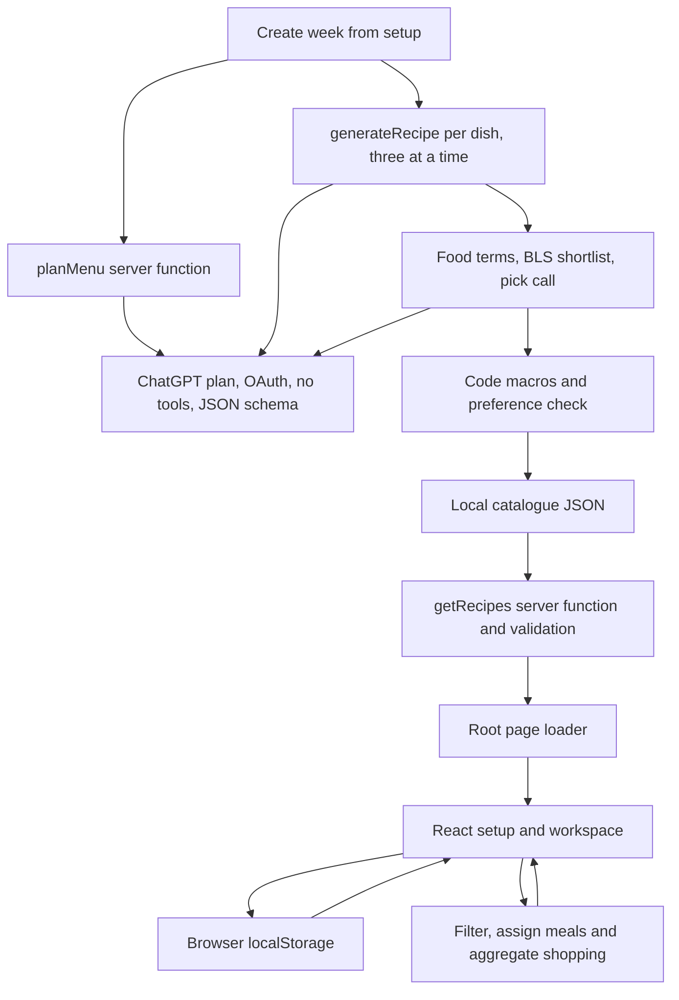
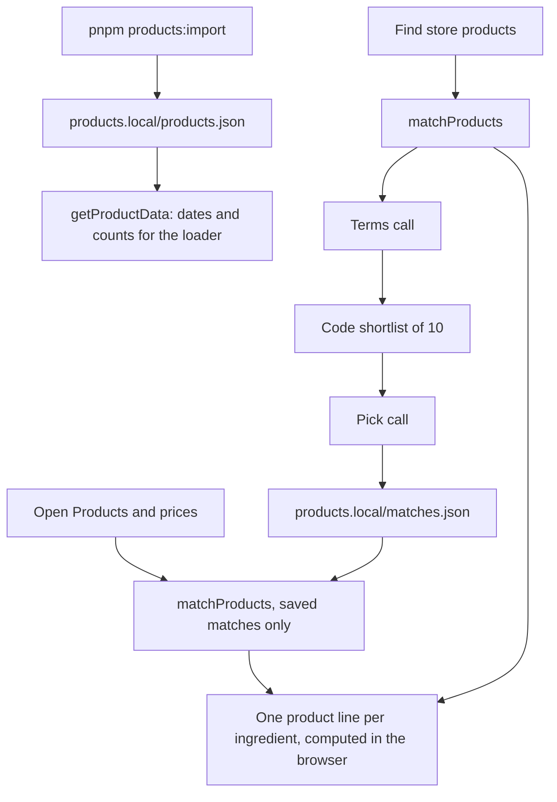

# Architecture

Batchday is a private, single-user meal planner built with TypeScript, React, TanStack Start and Vite. Its Node runtime can run locally or on the owner's homeserver. User-state persistence, deployment access control, source quality and broader UI verification remain separate work.

[PRODUCT.md](PRODUCT.md) records current capabilities and open product decisions. [README.md](README.md) covers setup and contribution boundaries. Personal assistant instructions and installed skills remain local and are excluded from Git.

## Current data flow

Generation runs only on explicit week creation, never on page loads. A week run is driven by the browser: `planMenu` returns one dish per selected day and meal, then `generateRecipe` writes each dish, three requests at a time. The server maps validated preferences to prompt rules, saves only recipes that pass `filterRecipes` (one retry otherwise) and returns the new ID. After each save the client runs a serialized loader refresh, then fills the dish's day, or the first open slot for that meal. Failed slots remain visibly unfilled and may use compatible saved recipes. The plan is replaced only once a menu exists. A first run with no meals saves its requested schedule immediately so a failure keeps those choices. Menu errors offer retry or explicit saved-recipe assignment, which uses the same preference checks. Server functions hold no job state: leaving the page stops new requests, while requests already sent still save. Recipe chat and the `reviseRecipe` endpoint are removed; historical `source.basedOn` and `source.feedback` records remain valid.

Food lookup takes two steps. The recipe call never sees the BLS list: per ingredient it returns 1 to 3 food search terms and the edible grams. `shortlist` (character trigrams, rare words weighted, each term taking turns) picks 8 candidates per ingredient from the server-only snapshot, and a second small call returns one ID per ingredient from its own list, or none; `withFoodPicks` drops any other ID. The 8-recipe test week used about 18k input tokens in 17 calls, against about 350k in 9 calls when every recipe call carried all 2,567 foods (the ChatGPT route showed no prompt-cache reuse). Code calculates per-serving macros from the picked food IDs and edible grams. A missing catalogue file loads as an empty catalogue. The route loader receives the whole validated catalogue, non-secret connection status and product snapshot metadata through TanStack Start server functions; the browser then filters and calculates shopping locally.

`chatgpt-auth.ts` owns the installation's Sign in with ChatGPT OSS registration, PKCE/nonce/state checks, verified ID-token identity, private credential storage and serialized token renewal. The setup command listens only on loopback; a homeserver login can use an SSH callback tunnel. `chatgpt.ts` obtains an OAuth token, lists account-specific models, then calls the public Responses endpoint with `store: false`, `stream: true`, JSON schema and no tools. A 120-second timeout and 4 MB stream limit bound requests. Recipe text is accumulated from stream deltas because the terminal output array can be empty. Only after `response.completed` can parsed JSON reach catalogue validation and saving; refusals, usage errors, malformed and interrupted streams leave the catalogue unchanged. Provider failures are not automatically retried; recipe-validation failures retain one retry.

### Product matching

Product suggestions are optional. `pnpm products:import` downloads the unofficial Heisse Preise dump, keeps priced products with a pack size in g, ml or pieces for BILLA, SPAR, HOFER, Lidl and PENNY, refuses a dump that looks incomplete (10,000 items or fewer, or 1,000 BILLA products or fewer) and writes the snapshot atomically. `products.ts` parses it again only when the file changes and gives the loader just the download time plus each store's latest price change and product count.

Opening **Products & prices** on Shopping calls `matchProducts` with `cachedOnly`, which reads saved matches without AI calls; new matching runs only from **Find**. The disclosure starts closed and the generic shopping list works without it. The validator keeps one name per ingredient ID, skips names over 80 characters and rejects more than 200. Find handles ingredients without a usable saved match in batches of 40: a terms call turns the names into 2 or 3 German shop search terms, including the usual shelf name (e.g. Eier Bodenhaltung, Teebutter), `shortlist` takes 10 products per item from that store's snapshot, and a pick call returns the suitable IDs from each item's own list, best first. The pick schema's per-item cap equals the 10 candidates; a strict cap of 6 made the model cram IDs into one string and derail. `listAnswer` keeps only the item's own IDs. Unusable answers stay unsaved, so the next Find retries them; a deliberate empty pick, or usable terms without any candidate, saves `[]` (nothing fits). Each batch is saved to `matches.json` before the next starts, through a serialized read/merge/write with temp file and rename; after a failed batch the client reloads what earlier batches saved. Previous live checks measured 23 to 29 s for 18 BILLA ingredients, most of it in the pick call.

The browser groups shopping rows by ingredient ID and computes one `ProductLine` per ingredient with `chooseProduct`; the total, its "N of M ingredients" count and the copied list derive from those lines. Results, errors and manual choices carry their store, so a late answer never shows on another store's list.

There is no database service, application user authentication, server-side plan persistence, service worker or background synchronization. Local files remove runtime source requests; that alone does not make the app fully usable offline.

## File responsibilities

| Location | Responsibility |
| --- | --- |
| [src/lib/types.ts](src/lib/types.ts) | Shared recipe, ingredient, filter, schedule, plan, shopping and store product (`StoreProduct`, `PickRule`, `ProductLine`) contracts. |
| [src/lib/recipes.ts](src/lib/recipes.ts) | Pure catalogue/preference/menu validation, setup option lists, discovery, weekly assignment, live slot filling, alternatives, daily macro totals, quantity normalization, shopping arithmetic, food/product shortlists, model-answer validation, product lines and product choice. No React or storage dependency. |
| [src/lib/recipes.test.ts](src/lib/recipes.test.ts) | Domain examples and edge cases, including scaling, missing data, units, filters, meal slots, shortlists, model picks and pack math. |
| [src/lib/nutrition.ts](src/lib/nutrition.ts) | Pure all-or-nothing nutrient calculation from explicit ingredient grams, with [focused tests](src/lib/nutrition.test.ts). |
| [src/lib/catalog.ts](src/lib/catalog.ts) | Server-only catalogue/BLS reads, menu planning, per-dish generation with two-step food lookup and code-side preference checks, mapping, calculated nutrition and serialized atomic append. Main recipe-storage boundary. |
| [src/lib/products.ts](src/lib/products.ts) | Server-only product snapshot reads, `getProductData` metadata, `matchProducts` (terms call, shortlist, pick call) and serialized saves of matches. Product-storage boundary. |
| [scripts/import-products.mjs](scripts/import-products.mjs) | `pnpm products:import`: downloads the Heisse Preise dump and writes the private product snapshot. |
| [src/lib/chatgpt.ts](src/lib/chatgpt.ts) | Subscription-authorized model requests, completed stream parsing and safe provider errors. |
| [src/lib/chatgpt-auth.ts](src/lib/chatgpt-auth.ts) | Private account credentials, OAuth verification and serialized token refresh. |
| [scripts/chatgpt-login.ts](scripts/chatgpt-login.ts) | Installation-owner login, connection status and logout command. |
| [data/nutrition.json](data/nutrition.json) | 2,567 BLS groceries as bought, per 100 g edible portion. [Metadata](data/nutrition-source.json) preserves licence/source/selected IDs; [importer](scripts/import-nutrition.mjs) reproduces the snapshot. Never loaded into the client bundle. |
| [src/routes/index.tsx](src/routes/index.tsx) | Route loader/search, four setup screens, Week/Shopping views, recipe details, browser persistence and event handlers. |
| [src/routes/__root.tsx](src/routes/__root.tsx) | HTML document, English language, metadata and stylesheet. |
| [src/router.tsx](src/router.tsx) | Router creation, generated tree and scroll restoration. |
| [src/routeTree.gen.ts](src/routeTree.gen.ts) | Generated route registry; regenerate from route files, do not edit by hand. |
| [src/styles.css](src/styles.css) | Shared visual design and responsive layouts. |
| [THIRD_PARTY.md](THIRD_PARTY.md) | BLS attribution and separate data licensing, Heisse Preise product data terms; the public app uses supermarket names without brand artwork. |
| [vite.config.ts](vite.config.ts) | Active TanStack Start/React build and loopback development server configuration. |
| [wrangler.jsonc](wrangler.jsonc) | Retained Cloudflare scaffold; not an active deployment or database configuration. |

The app currently has one page route, `/`. Full recipe pages use `/?recipe=<id>` and optionally `&slot=<day>-<meal>` for a weekly meal or `&slot=recipe:<id>` for an unscheduled extra; they render a page rather than a modal. The optional slot identifies the plan item being edited. Tabs and setup screens are React state, not separate routes.

## Storage and ownership

| Store | Contents and lifecycle |
| --- | --- |
| `data/recipes.local/catalog.json` | Generated recipes and historical immutable feedback variants; appends serialize the latest read/write inside one Node process, using unique temp files + rename. Absent means empty. |
| `data/products.local/products.json` | Private Heisse Preise snapshot written by `pnpm products:import`: download time, then per store the latest price change and products (ID, name, price, pack quantity in g/ml/pieces, organic and sold-by-weight flags, BILLA link). Absent means no product suggestions. |
| `data/products.local/matches.json` | Saved matches per store and ingredient ID: suitable product IDs, or `[]` when nothing fits. A missing entry, or one whose products all left the snapshot, is matched by the next Find. Written only by Find, serialized inside one Node process with temp file + rename. |
| `localStorage["batchday-poc"]` | This browser origin's store, preferences, setup progress, schedule, plan, pantry, active tab, shopping checks, `pickRule` and `productChoices` (manual product ID per `<store>:<ingredient id>`). Matched product lists are not stored in the browser. |
| `~/.config/batchday` or `BATCHDAY_AUTH_DIR` | Owner-only OAuth credential record and separate stable host ID. Kept outside the repo/web root and persisted across service restarts. |

The `*.local` ignore rule keeps the catalogue, product snapshot, saved matches and proof files out of version control. It does **not** prevent files under `public/` from being served or included in builds. Historical corrections remain separate records linked to their parent; the simplified app does not create new revisions.

Source releases also exclude local assistant/editor configuration, environment files and private artifacts. Catalogue paths are repository-relative; OAuth credentials are installation-owned and outside the repo. Every clone authorizes its own ChatGPT plan and downloads its own product snapshot. Application code is MIT licensed; BLS data retains CC BY 4.0, and Heisse Preise data is never redistributed, as recorded in [THIRD_PARTY.md](THIRD_PARTY.md).

Browser restoration runs once and validates known options, ingredient/recipe references, portions and meal slots. Loader refreshes after generation do not restore stale saved state. Plan entries for missing recipe IDs are dropped; compatible settings remain. The existing `batchday-poc` key is retained. Old Recipes/This week tabs open Week; Shopping stays Shopping. Removed discovery restrictions (search, time, difficulty, ingredient count and pantry-only) reset on restoration so invisible controls cannot constrain a new plan; diet, allergen exclusions, dislikes and supported tags remain. A recipe detail can update planned servings only when both its slot and recipe ID match the current plan. This is local validation, not a versioned multi-user persistence layer. Different ports/origins have different localStorage.

## Product and domain rules

- Setup is supermarket → preferences → pantry → schedule. Completing it opens Week, with Shopping as the only other workspace view. Recipe details open from planned meals. Images, catalogue browsing and recipe chat are absent. The supermarket selects which product snapshot is matched; it never asserts stock.
- A schedule contains unique weekdays (`0` = Monday), selected meal types and portions from 1 to 12. It is a reusable weekly pattern, without calendar dates or week history.
- With ChatGPT connected, creating a week generates one recipe per scheduled meal as described above. Setup options (allergens, tags, pantry staples, common dislikes) are fixed lists, so preferences work on an empty catalogue. Five main choices cover one pot, high protein, keto, low calorie and meal prep; diet, allergens and dislikes live in a disclosure.
- Meal swaps use saved, preference-matching recipes with known servings and compatible meal types. There are no pre-generated extras or daily macro totals in the interface.
- Without a connection, `generateWeeklyPlan` applies preferences and meal compatibility, requires known servings and prefers the least-used eligible recipe. Ties follow catalogue order; assignment is deterministic, not random or nutritionally optimized. Unsupported slots are reported as unfilled.
- A slotted plan item is identified by day and meal, allowing one recipe on several days. Extra unscheduled items use recipe identity. Editing preferences/pantry retains the plan; explicitly creating a new week replaces it. Plan/pantry mutations clear purchase checks because quantities may change.
- Vegetarian includes vegan. High protein requires at least 25 g protein per serving, Keto at most 10 g carbs and Low calorie at most 500 kcal. `filterRecipes` checks calculated numbers rather than trusting recipe tags; missing macros fail those choices. One-pot and meal-prep remain generated labels. Keto is a per-meal carbohydrate cap, not a guarantee about the entire day's diet.
- Pantry starts with common staples and can search ingredients in saved recipes, deduplicated by ingredient ID. Choices represent presence rather than measured stock. Olivenöl and Rapsöl have separate identities; a restored generic oil selection remains labelled Öl (unspecified), without equating it to either oil. Shopping excludes selected pantry ingredients and water.
- English recipe text and search aliases coexist with German grocery names. Grocery identity is the generic German ingredient ID. Cuts, cooked/raw forms and unresolved alternatives must remain distinct.
- Shopping scales amounts by planned portions / recipe servings. Missing yields need an explicit base before reliable scaling; missing amounts stay visible. Known subtotals are never presented as complete amounts for unresolved rows.
- Aggregation merges matching ingredient IDs, compatible normalized units and matching preparation notes. Kilograms become grams; litres/decilitres/centilitres become millilitres. Mass and volume are not interchangeable. Whole `Stück` quantities round up only after summation. Display formatting uses Austrian decimals.
- Product suggestions sit beside the generic rows and never change them. Rows of one ingredient (split by unit or unknown amount) share one product line, shown on the first row. Rows in the product's unit (g, ml or Stück) add up to whole packs, ignoring float noise; with no comparable row a packed product counts one pack. A product sold by weight is costed for the amount in its unit and has no cost without one (pieces, spoons, to taste). A line is flagged "check amount" when a row cannot be compared with the pack, except up to 4 spoons or pinches of a packed product.
- Cheapest considers every suitable product; Store brand first (BILLA: Clever, BILLA, Ja! Natürlich, Da komm ich her!; SPAR: S-Budget, SPAR) and Organic first narrow to those products when any exist. Lines rank by cost, flagged or not (the unflagged line wins a tie). A weighed cost covers the exact amount; outside fruit and vegetables, which are weighed out loose, it is only a lower bound (a whole loaf, a meat pack), so it shows as "from" and ranks after the other costed lines. Lines without a cost come last. A manual choice wins while it is still suitable. The total adds the lines with a cost. A store's prices are marked possibly out of date when its latest price change is more than 7 days older than the download.
- Nutrition is **per-serving** kcal/protein/carbs/fat, calculated by summing BLS values × edible grams / 100, then dividing by servings. Ingredient nutrition mappings remain separate from shopping units; the model estimates edible grams for pieces/volumes, and explicit g amounts take precedence. Any missing food match, weight or nutrient value prevents a complete total, except herbs and spices (category Gewürze): one without a match counts as zero. Increasing cooked portions scales ingredients, not the displayed per-portion macros. Daily targets and day optimization are absent.
- Source and nutrition metadata travel with the record. Dietary/allergen detection and unspecified ingredient amounts still need review; filters do not establish a complete allergy guarantee.

## Reuse and production boundaries

| Area | Reuse | Work before a hosted/private service |
| --- | --- | --- |
| Domain contracts and arithmetic | Keep the framework-independent types, helpers and regression cases. | Extend tests only for real new rules; preserve uncertainty and unit boundaries. |
| Journey, design and recipe views | Keep working interactions and styling. | Complete English-collection browser/mobile proof. Split the large `Home` component when a concrete change needs an independent screen or persistence boundary. |
| Catalogue loading | Keep validation and `Recipe` output. | Replace Node filesystem access when using Workers/D1 or another host; preserve error handling. Avoid generating on page requests. |
| Recipe generation | Keep schema, prompt, OAuth model call, `toGeneratedRecipe` mapping and validation. | Persist the private auth directory for the Node service. A service offered to others requires a separate provider/access-control review. |
| Personal state | Keep schedule/plan semantics and restore safeguards. | Decide whether browser-only storage is enough. For account sync, add authenticated ownership, persistence and explicit schema/catalogue migrations. |
| Nutrition and filters | Keep disclosed gaps. | Review food identities, ambiguous quantities, dietary/allergen rules and nutrition before daily macro tailoring. |
| Hosting/privacy | Keep the private-use boundary. | Add access control before public deployment. The server function returns the catalogue and static assets are accessible; an ignored file or loopback dev bind is not deployment authentication. |
| Shopping integrations | Keep generic grocery aggregation, code-side pack/cost math and saved matches. | The Heisse Preise snapshot is unofficial and private; a service for others needs a price source it may redistribute. Stock is not covered. |

Cloudflare Workers and D1 are a possible future target; neither is active in the current runtime. The Cloudflare Vite dependency and generic Wrangler scaffold remain; the active Vite plugins are TanStack Start and React. The scaffold has no account IDs or deployed bindings. Do not treat it as a tested deployment path. No immediate rewrite or database abstraction is needed to keep iterating locally.

## Verification and safe changes

Run `pnpm test` for pure rules, `pnpm typecheck` for callers/contracts and `pnpm build` for client/server integration. Run `pnpm generate-routes` after route changes. Generation changes also need validation and inspection of real resulting records; keep the previous catalogue on failure. Matching changes need a live Find against the snapshot and a look at the saved matches.

For behavior changes, use the existing server and prove the affected journey: setup → automatic week → recipe navigation/swap → portion change → aggregated shopping and product suggestions → reload. Check both direct recipe URLs and normal navigation when changing routing. Never start a second dev server just for convenience; stop any temporary verification process afterwards.

Current evidence and its limits are in [PRODUCT.md](PRODUCT.md). Phone layouts and full browser-offline behavior still need manual proof. Documentation changes do not imply those checks were rerun.

Schedule drafts use validated `readSchedule` restoration and persist as `scheduleDraft` alongside `schedule` in `batchday-poc`. Only creating the week commits a draft; cancelling leaves active quantities and purchase checks unchanged. Product totals sum the same rounded cents shown on each line, and store/version guards prevent delayed results from replacing newer matches.

Start over reuses the setup controls with defaults and a persisted, validated `previousSetup` snapshot of store, preferences, pantry and shopping checks. Plan and active schedule remain intact. The snapshot distinguishes the four-step restart from individual setting edits; Cancel, Back to week and the home button restore it, while submitting the schedule discards it. Legacy storage without the optional snapshot restores as before. Regenerate week passes the active schedule to the existing generation flow and synchronizes `scheduleDraft` so retry uses that same schedule.

The optional `theme` field in `batchday-poc` accepts only `light` or `dark`; missing or invalid values use the device preference. The document shell restores a valid choice before page content renders, while CSS themes native controls with `color-scheme`. The route listens for device-theme changes while no explicit choice is saved. Theme changes preserve all existing plan fields.
